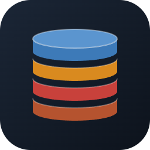
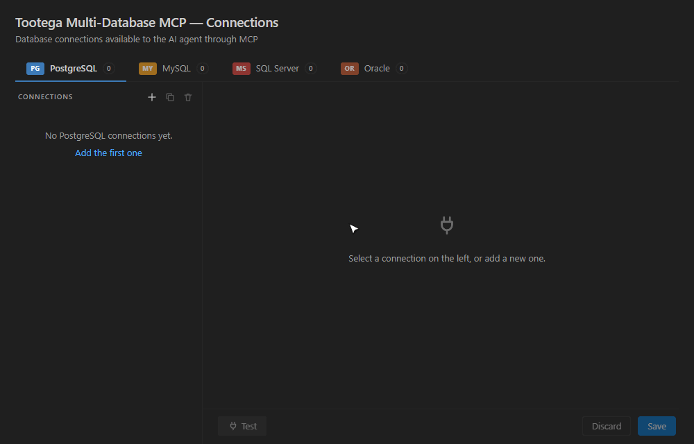
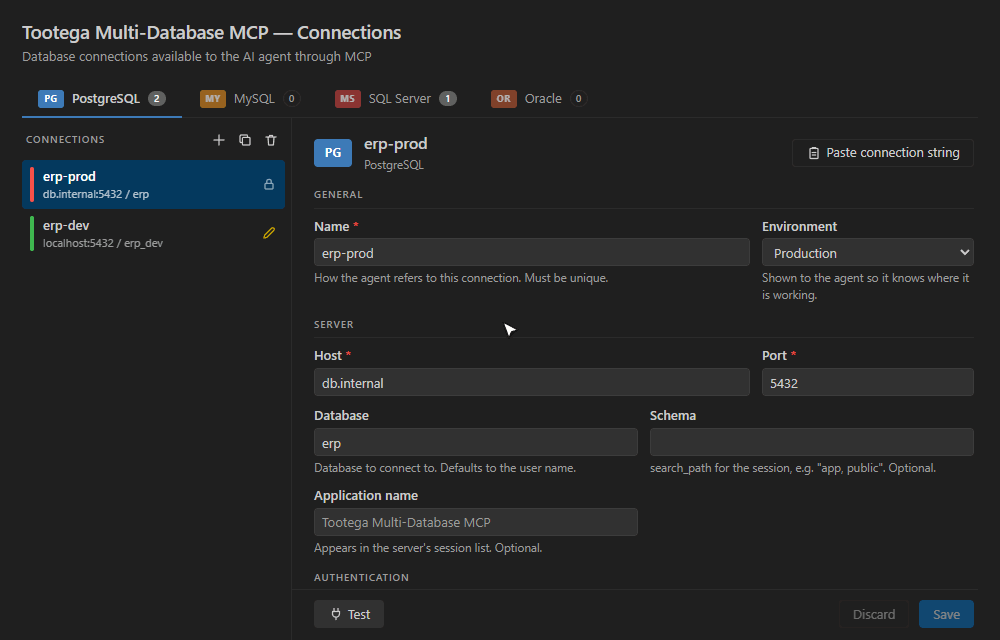
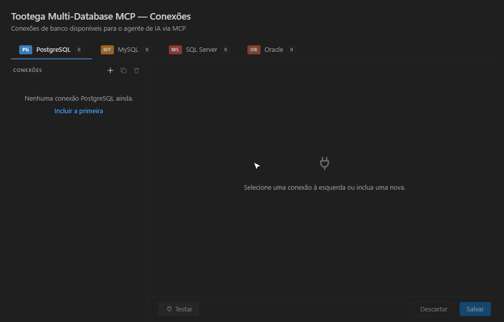
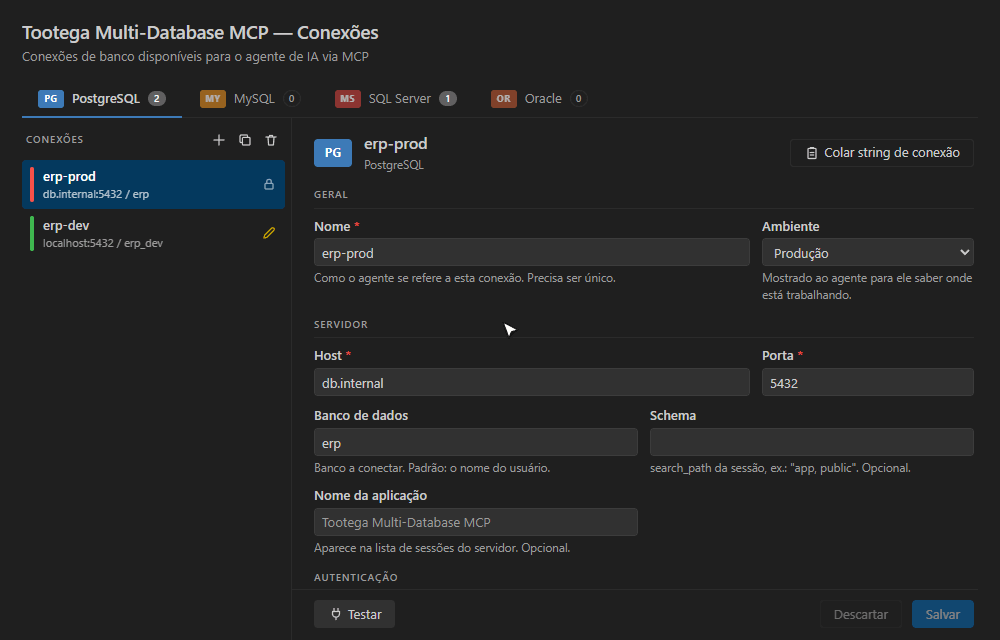

  

<h1 align="center">Tootega Multi-Database MCP</h1>

  <b>Give your AI agent safe, instant access to PostgreSQL, MySQL, SQL Server and Oracle.</b> 
  One MCP server. A native C core. Zero dependencies. Read-only by default.

  <b>English</b> &nbsp;|&nbsp; <a href="#português">Português</a>

---

## Why this one

| | |
|---|---|
| **Written in C, from the wire up** | Every database protocol is implemented natively — no ODBC, no JDBC, no client libraries, no runtime. The whole server is a **310 KB** executable. |
| **Starts before you notice** | **0.4 ms** to start, **0.6 ms** for a full MCP handshake, about **0.4 MB** of memory. Nothing to warm up, nothing to keep alive. |
| **Four databases, one tool set** | PostgreSQL, MySQL / MariaDB, SQL Server and Oracle behind the same ten tools. The agent learns them once. |
| **Read-only by default** | Every connection starts read-only, enforced in layers. Writing is an explicit, per-connection choice. |
| **Nothing to install** | No drivers, no Instant Client, no Node or Python packages. Install the extension and connect. |
| **English and Portuguese** | Interface, tool descriptions and error messages follow your VS Code language. |

## See it working

**PostgreSQL** — add a connection, fill it in, test and save:

**SQL Server** — paste a connection string and the form fills itself:

**Oracle** — service name, environment label and the write-access warning:

## Performance: what a native C core buys you

Most MCP servers are scripts running on top of a language runtime, talking to the database
through a driver that wraps another library. This one is a single native executable that speaks
each database's wire protocol directly. There is no interpreter to start, no garbage collector,
no dependency tree to load — and it shows.

| Measured | Tootega Multi-Database MCP | For scale |
|---|---|---|
| Executable size | **310 KB** (Linux) · **291 KB** (Windows) | a typical driver package is tens of MB |
| Process start | **0.35 ms** | an empty Node.js process: 13 ms |
| Full MCP handshake (start + `initialize` + `tools/list`) | **0.56 ms** | — |
| Memory in use | **0.3 MB** idle · **0.4 MB** after a 500-row query | an empty Node.js process: 43 MB |

Query round trip through the MCP server, on an open connection (median of 300 calls):

| Database | `SELECT 1` | 500 rows, 4 columns |
|---|---|---|
| PostgreSQL | **0.43 ms** | **1.1 ms** |
| MySQL (over TLS 1.3) | **0.49 ms** | **2.0 ms** |
| SQL Server | **0.69 ms** | **1.7 ms** |
| Oracle | **0.71 ms** | **2.2 ms** |

These times include the read-only safety envelope (a read-only transaction opened and rolled
back around every query). The server adds microseconds; what you wait for is your database.

Measured with `tools/bench/bench.js` on the statically linked Linux build, Intel Core i9-14900K,
databases in local containers. Your network latency will dominate real-world numbers.

What it means in practice:

- **The agent never waits on the tool.** Schema exploration is dozens of small calls; each one
  costs under a millisecond of overhead.
- **It does not weigh on your machine.** It uses a fraction of a megabyte — and only runs while
  VS Code needs it.
- **Results are shaped for the model.** Column names once, rows as compact arrays, hard limits on
  rows and cell size: fewer tokens, faster answers.

## What the agent can do

| Tool | What it does |
|---|---|
| `list_connections` | Lists the configured connections — name, database type, environment, read-only or not |
| `test_connection` | Connects, authenticates and reports server version and latency |
| `server_info` | Version, current user, database and default schema |
| `list_schemas` | Schemas of a connection (databases, on MySQL) |
| `list_tables` | Tables and views, with estimated row counts and a name filter |
| `describe_table` | Columns, types, nullability, defaults, primary and foreign keys, indexes |
| `search_columns` | Finds tables and columns by name across all schemas |
| `query` | Runs one read-only statement and returns the rows (JSON, CSV or Markdown) |
| `explain` | Shows the execution plan without running the query |
| `execute` | Runs DML / DDL — only on connections where you enabled writing |

Then just ask: *"Which tables reference `customers`, and which of them have no index on the
foreign key?"* — the agent explores the schema and answers with real data.

## Safe by design

- **Read-only is the default.** A new connection cannot change anything until you uncheck one box,
  and the interface tells you clearly when writing is enabled.
- **Layered enforcement.** A dialect-aware SQL guard accepts a single read statement and rejects
  write keywords outside literals and comments; on top of it, PostgreSQL, MySQL and Oracle run every
  query inside a read-only transaction that is always rolled back.
- **Passwords are stored encrypted for your user account** (Windows DPAPI; on Linux, an encrypted file only you can read), next to the connections file but never inside it. Any MCP client on your machine that starts the server uses them. They are never
  logged and never returned to the model.
- **Encrypted connections with a native TLS 1.3.** Implemented in the same C core — X25519 and
  P-256 key exchange, AES-GCM and ChaCha20-Poly1305, certificate chains with RSA and ECDSA. Choose
  per connection: *Prefer* (encrypt when the server offers it), *Require*, *Verify CA* or
  *Verify full* (chain and host name), using your system's trusted authorities or your own CA file.
- **Bounded results.** Row limits, cell-size limits and timeouts per connection.
- **Environment labels** (development, test, staging, production) are shown to you and to the agent.

For a real guarantee, also connect with a database user that only has read permission. The guard is
defence in depth, not a substitute for database permissions.

## Supported databases

| Database | Protocol | Authentication | Tested with |
|---|---|---|---|
| PostgreSQL | native v3 | SCRAM-SHA-256, MD5, password, trust | 17, 18 |
| MySQL / MariaDB | native client/server | `caching_sha2_password` (with RSA), `mysql_native_password` | MySQL 8.4, MariaDB 11 |
| SQL Server | TDS 7.4 | SQL login; named instances via SQL Browser | 2022 |
| Oracle | TNS / TTC | O5LOGON, 11g and 12c verifiers; service name or SID | 23ai (12.1 or newer) |

All cryptography — MD5, SHA-1, SHA-2, HMAC, PBKDF2, HKDF, AES-CBC/GCM, ChaCha20-Poly1305, RSA,
X25519 and ECDSA / ECDH on P-256 and P-384 — is implemented in the core and checked against
published test vectors (`tmdb selftest`). TLS 1.3 is tested against PostgreSQL, MySQL, MariaDB,
SQL Server 2022 and OpenSSL.

## Getting started

1. Install the extension.
2. Open the Command Palette and run **Tootega Multi-Database MCP: Configure Connections**
   (or click **MDB** in the status bar).
3. Pick the database tab, click **+**, fill in the form — or paste a connection string — and press
   **Test**.
4. **Save**. The MCP server is registered automatically; open the chat in agent mode and ask about
   your data.

Requires VS Code 1.101 or newer, on Windows x64 or Linux x64.

### Using it outside VS Code

**Claude Code needs nothing**: when the Claude Code CLI is installed, the extension registers the
server there by itself (user scope, name `tootega-mdb`) and keeps the entry up to date. Turn it off
with the `tootegaMdb.registerClaudeCode` setting.

The server is a standalone executable. For Cursor or any other MCP client, run **Copy MCP
Configuration for Other Clients** to get a ready-made snippet. The connections and saved
passwords you configured here work there too — no extra setup.

## Settings

| Setting | Purpose |
|---|---|
| `tootegaMdb.language` | `auto` (follow VS Code), `en` or `pt` |
| `tootegaMdb.serverPath` | Use your own build of the `tmdb` executable |
| `tootegaMdb.registerClaudeCode` | Keep the server registered in Claude Code automatically (on by default) |
| `tootegaMdb.verbose` | Write a diagnostic log to the server output |

## Current limitations

- **TLS 1.3 only.** Servers limited to TLS 1.2 or older cannot be reached with encryption: in
  *Prefer* mode the connection falls back to unencrypted, in *Require* it is refused with a clear
  message. This affects SQL Server before 2022 (and 2022 without TLS 1.3 enabled) and older
  PostgreSQL / MySQL builds.
- The TLS implementation is new and has not been independently audited. It is tested against real
  servers and published test vectors, but treat it accordingly for high-risk networks.
- Oracle over TLS (TCPS) is implemented but not yet verified against a TCPS listener.
- SQL Server: SQL logins only (no Windows / Entra ID authentication yet). Non-Unicode text is
  decoded as Windows-1252 unless the column collation is UTF-8.
- Oracle: database 12.1 or newer; listener redirects (shared server, some RAC setups) and Native
  Network Encryption are not supported yet.
- Platforms: Windows x64 and Linux x64.

---

<h1 align="center" id="português">Tootega Multi-Database MCP</h1>

  <b>Dê ao seu agente de IA acesso seguro e instantâneo a PostgreSQL, MySQL, SQL Server e Oracle.</b> 
  Um servidor MCP. Núcleo nativo em C. Zero dependências. Somente leitura por padrão.

  <a href="#tootega-multi-database-mcp">English</a> &nbsp;|&nbsp; <b>Português</b>

---

## Por que este

| | |
|---|---|
| **Escrito em C, do protocolo para cima** | O protocolo de cada banco é implementado nativamente — sem ODBC, sem JDBC, sem bibliotecas cliente, sem runtime. O servidor inteiro é um executável de **310 KB**. |
| **Inicia antes de você perceber** | **0,4 ms** para iniciar, **0,6 ms** para o aperto de mão MCP completo, cerca de **0,4 MB** de memória. Nada para aquecer, nada para manter vivo. |
| **Quatro bancos, um só conjunto de ferramentas** | PostgreSQL, MySQL / MariaDB, SQL Server e Oracle atrás das mesmas dez ferramentas. O agente aprende uma vez. |
| **Somente leitura por padrão** | Toda conexão nasce somente leitura, com proteção em camadas. Escrever é uma escolha explícita, por conexão. |
| **Nada para instalar** | Sem drivers, sem Instant Client, sem pacotes Node ou Python. Instale a extensão e conecte. |
| **Português e inglês** | Interface, descrições das ferramentas e mensagens de erro seguem o idioma do seu VS Code. |

## Veja funcionando

**PostgreSQL** — incluir uma conexão, preencher, testar e salvar:

**SQL Server** — cole a string de conexão e o formulário se preenche sozinho:

**Oracle** — service name, rótulo de ambiente e o aviso de escrita liberada:

## Desempenho: o que um núcleo nativo em C entrega

A maioria dos servidores MCP são scripts rodando sobre o runtime de uma linguagem, falando com o
banco por um driver que embrulha outra biblioteca. Este é um único executável nativo que fala
diretamente o protocolo de rede de cada banco. Não há interpretador para iniciar, coletor de lixo
nem árvore de dependências para carregar — e isso aparece nos números.

| Medido | Tootega Multi-Database MCP | Para comparar |
|---|---|---|
| Tamanho do executável | **310 KB** (Linux) · **291 KB** (Windows) | um pacote de driver típico tem dezenas de MB |
| Partida do processo | **0,35 ms** | um processo Node.js vazio: 13 ms |
| Aperto de mão MCP completo (partida + `initialize` + `tools/list`) | **0,56 ms** | — |
| Memória em uso | **0,3 MB** ocioso · **0,4 MB** após consulta de 500 linhas | um processo Node.js vazio: 43 MB |

Ida e volta de uma consulta pelo servidor MCP, com a conexão já aberta (mediana de 300 chamadas):

| Banco | `SELECT 1` | 500 linhas, 4 colunas |
|---|---|---|
| PostgreSQL | **0,43 ms** | **1,1 ms** |
| MySQL (sobre TLS 1.3) | **0,49 ms** | **2,0 ms** |
| SQL Server | **0,69 ms** | **1,7 ms** |
| Oracle | **0,71 ms** | **2,2 ms** |

Esses tempos já incluem o envelope de segurança de leitura (uma transação somente leitura aberta e
desfeita em volta de cada consulta). O servidor acrescenta microssegundos; o que você espera é o
seu banco.

Medido com `tools/bench/bench.js` no build Linux linkado estaticamente, Intel Core i9-14900K,
bancos em containers locais. Em uso real, a latência da sua rede domina os números.

O que isso significa na prática:

- **O agente nunca espera pela ferramenta.** Explorar um schema são dezenas de chamadas pequenas;
  cada uma custa menos de um milissegundo de sobrecarga.
- **Não pesa na sua máquina.** Usa uma fração de megabyte — e só roda enquanto o VS Code precisa.
- **Resultados no formato certo para o modelo.** Nomes de coluna uma vez só, linhas como arrays
  compactos, limite firme de linhas e de tamanho de célula: menos tokens, respostas mais rápidas.

## O que o agente pode fazer

| Ferramenta | O que faz |
|---|---|
| `list_connections` | Lista as conexões configuradas — nome, tipo de banco, ambiente, somente leitura ou não |
| `test_connection` | Conecta, autentica e informa versão do servidor e latência |
| `server_info` | Versão, usuário atual, banco e schema padrão |
| `list_schemas` | Schemas de uma conexão (bancos, no MySQL) |
| `list_tables` | Tabelas e views, com contagem estimada de linhas e filtro por nome |
| `describe_table` | Colunas, tipos, nulabilidade, padrões, chaves primária e estrangeiras, índices |
| `search_columns` | Encontra tabelas e colunas pelo nome em todos os schemas |
| `query` | Executa uma instrução de leitura e devolve as linhas (JSON, CSV ou Markdown) |
| `explain` | Mostra o plano de execução sem executar a consulta |
| `execute` | Executa DML / DDL — só em conexões onde você liberou a escrita |

Depois é só perguntar: *"Quais tabelas referenciam `clientes`, e quais delas não têm índice na
chave estrangeira?"* — o agente explora o schema e responde com dados reais.

## Seguro por construção

- **Somente leitura é o padrão.** Uma conexão nova não altera nada até você desmarcar uma caixa, e a
  interface deixa claro quando a escrita está liberada.
- **Proteção em camadas.** Uma guarda de SQL que conhece cada dialeto aceita uma única instrução de
  leitura e recusa palavras de escrita fora de literais e comentários; por cima dela, PostgreSQL,
  MySQL e Oracle executam toda consulta dentro de uma transação somente leitura, sempre desfeita.
- **Senhas ficam cifradas para a sua conta de usuário** (DPAPI no Windows; no Linux, arquivo cifrado que só você lê), ao lado do arquivo de conexões mas nunca dentro dele. Valem para qualquer cliente MCP da sua máquina que inicie o servidor. Nunca
  aparecem em log e nunca voltam para o modelo.
- **Conexões criptografadas com TLS 1.3 nativo.** Implementado no mesmo núcleo em C — troca de
  chaves X25519 e P-256, AES-GCM e ChaCha20-Poly1305, cadeias de certificado com RSA e ECDSA.
  Escolha por conexão: *Preferir* (cifra quando o servidor oferece), *Exigir*, *Verificar CA* ou
  *Verificação completa* (cadeia e nome do host), com as autoridades confiáveis do seu sistema ou
  o seu próprio arquivo de CA.
- **Resultados com limite.** Limite de linhas, de tamanho de célula e de tempo, por conexão.
- **Rótulos de ambiente** (desenvolvimento, teste, homologação, produção) visíveis para você e para
  o agente.

Para garantia real, conecte também com um usuário de banco que só tenha permissão de leitura. A
guarda é defesa em profundidade, não substitui as permissões do banco.

## Bancos suportados

| Banco | Protocolo | Autenticação | Testado com |
|---|---|---|---|
| PostgreSQL | nativo v3 | SCRAM-SHA-256, MD5, senha, trust | 17, 18 |
| MySQL / MariaDB | cliente/servidor nativo | `caching_sha2_password` (com RSA), `mysql_native_password` | MySQL 8.4, MariaDB 11 |
| SQL Server | TDS 7.4 | login SQL; instâncias nomeadas via SQL Browser | 2022 |
| Oracle | TNS / TTC | O5LOGON, verificadores 11g e 12c; service name ou SID | 23ai (12.1 ou mais novo) |

Toda a criptografia — MD5, SHA-1, SHA-2, HMAC, PBKDF2, HKDF, AES-CBC/GCM, ChaCha20-Poly1305, RSA,
X25519 e ECDSA / ECDH em P-256 e P-384 — é implementada no núcleo e conferida com vetores de teste
publicados (`tmdb selftest`). O TLS 1.3 é testado contra PostgreSQL, MySQL, MariaDB,
SQL Server 2022 e OpenSSL.

## Como começar

1. Instale a extensão.
2. Abra a Paleta de Comandos e execute **Tootega Multi-Database MCP: Configurar Conexões**
   (ou clique em **MDB** na barra de status).
3. Escolha a aba do banco, clique em **+**, preencha o formulário — ou cole uma string de conexão —
   e pressione **Testar**.
4. **Salvar**. O servidor MCP é registrado automaticamente; abra o chat em modo agente e pergunte
   sobre os seus dados.

Requer VS Code 1.101 ou mais novo, em Windows x64 ou Linux x64.

### Usando fora do VS Code

**O Claude Code não precisa de nada**: com o CLI do Claude Code instalado, a extensão registra o
servidor lá sozinha (escopo do usuário, nome `tootega-mdb`) e mantém a entrada atualizada. Para
desligar, use a configuração `tootegaMdb.registerClaudeCode`.

O servidor é um executável independente. Para o Cursor ou qualquer outro cliente MCP, execute
**Copiar Configuração MCP para Outros Clientes** para obter um trecho pronto. As conexões e
senhas que você configurou aqui valem lá também, sem configuração extra.

## Configurações

| Configuração | Finalidade |
|---|---|
| `tootegaMdb.language` | `auto` (segue o VS Code), `en` ou `pt` |
| `tootegaMdb.serverPath` | Usar o seu próprio build do executável `tmdb` |
| `tootegaMdb.registerClaudeCode` | Manter o servidor registrado no Claude Code automaticamente (ligado por padrão) |
| `tootegaMdb.verbose` | Gravar um log de diagnóstico na saída do servidor |

## Limitações atuais

- **Somente TLS 1.3.** Servidores limitados ao TLS 1.2 ou anterior não são alcançados com
  criptografia: no modo *Preferir* a conexão cai para sem cifra, no *Exigir* é recusada com uma
  mensagem clara. Isso afeta SQL Server anterior ao 2022 (e o 2022 sem TLS 1.3 habilitado) e
  versões antigas de PostgreSQL / MySQL.
- A implementação de TLS é nova e não passou por auditoria independente. É testada contra
  servidores reais e vetores de teste publicados, mas leve isso em conta em redes de alto risco.
- Oracle sobre TLS (TCPS) está implementado, mas ainda não foi verificado contra um listener TCPS.
- SQL Server: somente login SQL (ainda sem autenticação Windows / Entra ID). Texto não Unicode é
  decodificado como Windows-1252, a menos que a ordenação da coluna seja UTF-8.
- Oracle: banco 12.1 ou mais novo; redirecionamento do listener (shared server, alguns ambientes
  RAC) e a criptografia nativa de rede (NNE) ainda não são suportados.
- Plataformas: Windows x64 e Linux x64.
