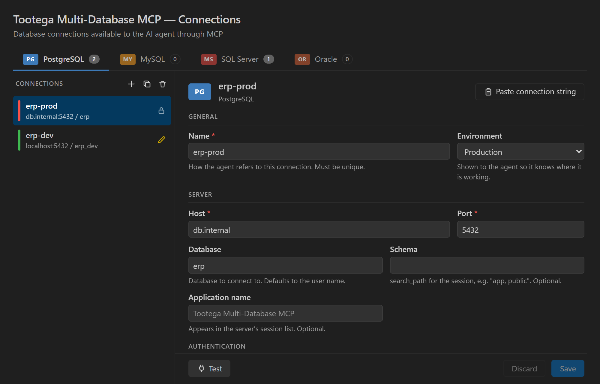

## Ask about your data

Open the chat in **agent mode**. The tools of **Tootega Multi-Database MCP** are available as soon
as you save a connection. Try:

- *"List my database connections."*
- *"Describe the `orders` table and its foreign keys."*
- *"Which customers placed more than 10 orders last month?"*

The agent explores the schema with `list_tables` and `describe_table`, then writes and runs the SQL.
On read-only connections it can only read — changes need a connection where you enabled writing.

