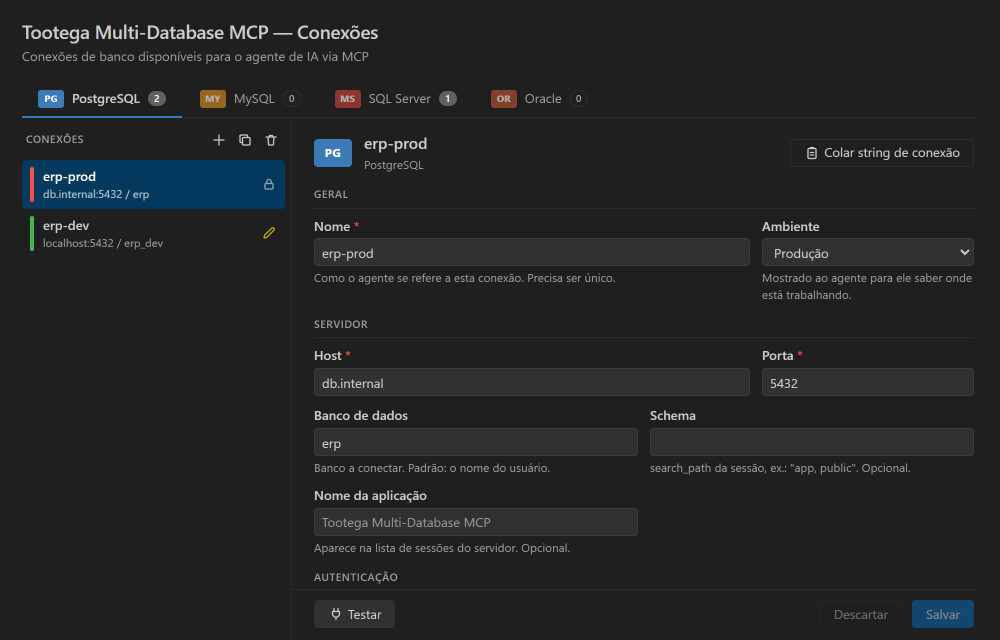

## Pergunte sobre os seus dados

Abra o chat em **modo agente**. As ferramentas do **Tootega Multi-Database MCP** ficam disponíveis
assim que você salva uma conexão. Experimente:

- *"Liste as minhas conexões de banco."*
- *"Descreva a tabela `pedidos` e as chaves estrangeiras dela."*
- *"Quais clientes fizeram mais de 10 pedidos no mês passado?"*

O agente explora o schema com `list_tables` e `describe_table`, depois escreve e executa o SQL.
Em conexões somente leitura ele só lê — alterações exigem uma conexão com a escrita liberada.

