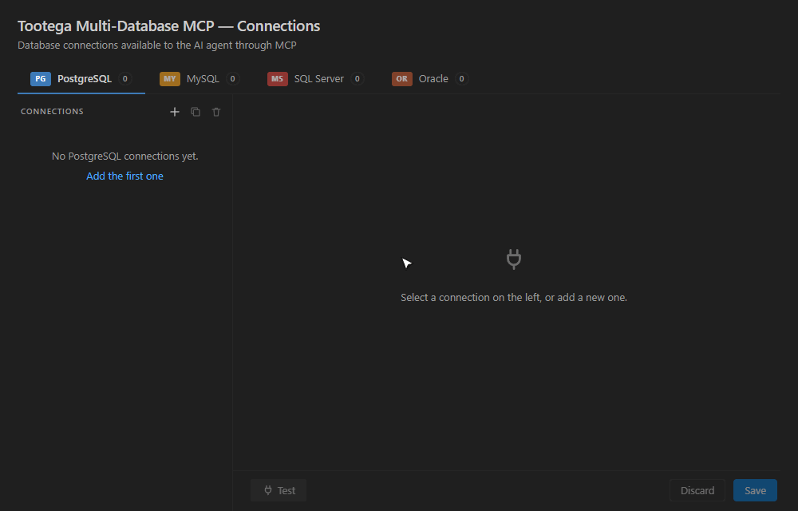
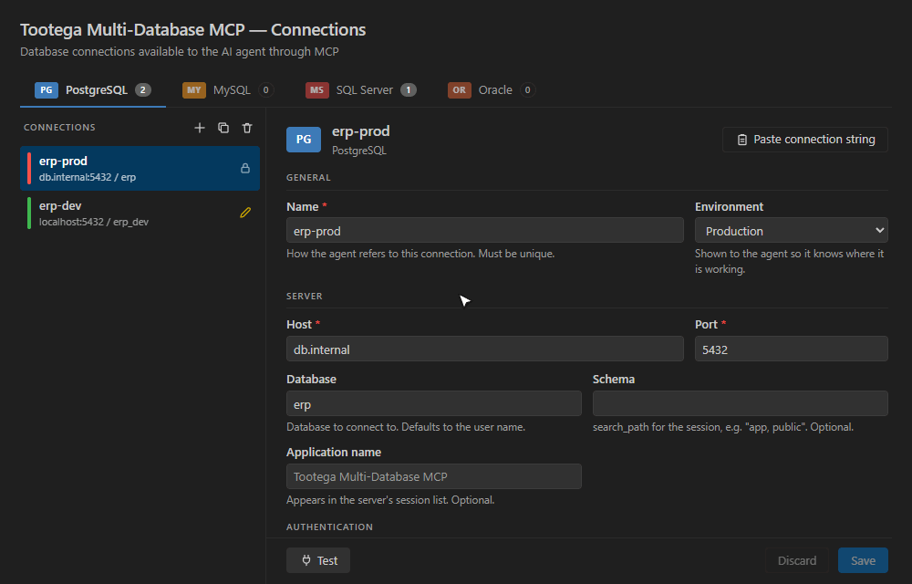

## Add your first connection

Pick the database tab, click **+**, fill in the form and press **Test**.
Every connection starts **read-only**; the password goes to your operating system keychain.

Already have a connection string? Use **Paste connection string** and the form fills itself:

