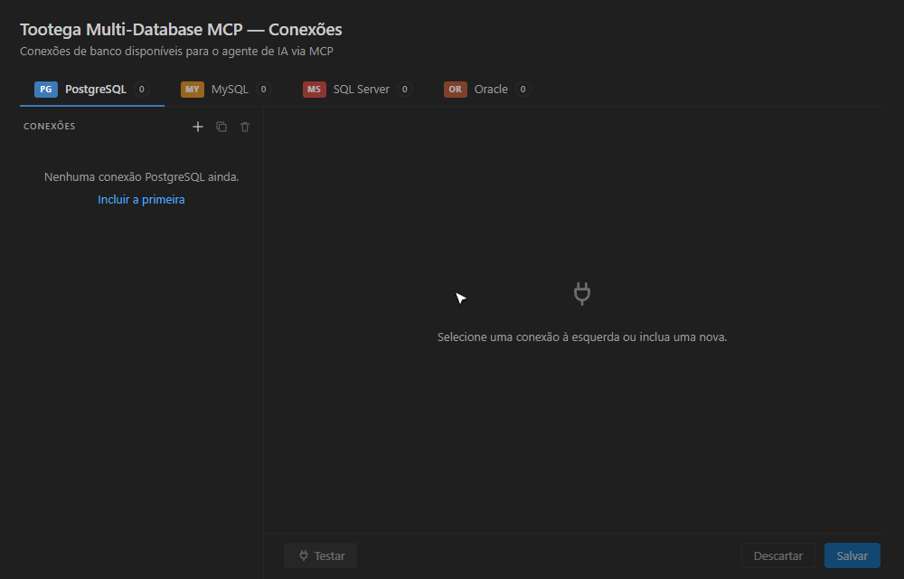
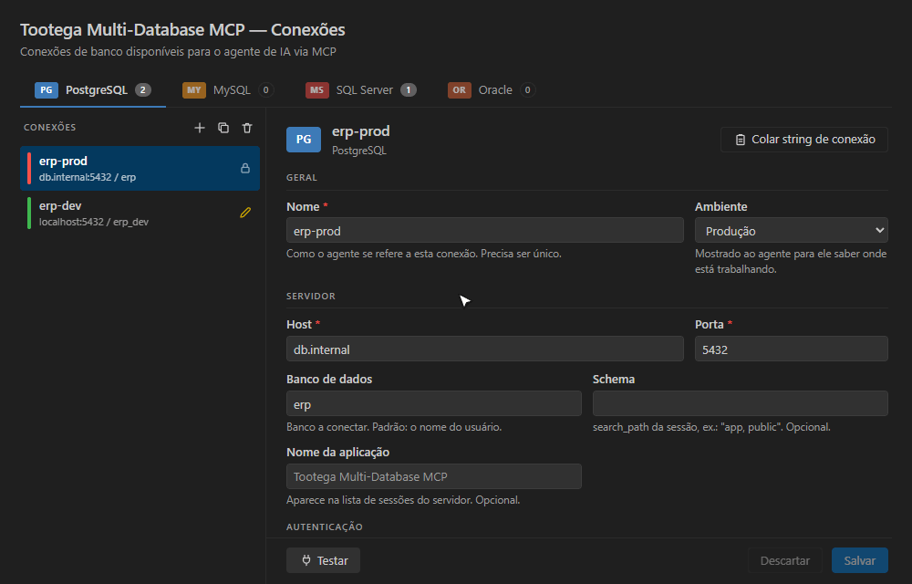

## Inclua a sua primeira conexão

Escolha a aba do banco, clique em **+**, preencha o formulário e pressione **Testar**.
Toda conexão nasce **somente leitura**; a senha vai para o cofre do sistema operacional.

Já tem uma string de conexão? Use **Colar string de conexão** e o formulário se preenche sozinho:

